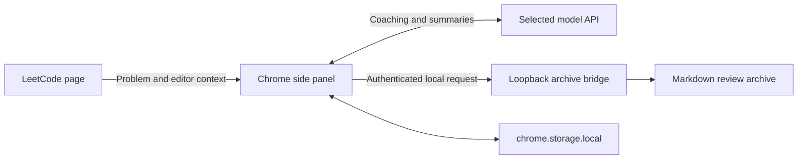

# leetcoach

A Chrome side-panel extension for deliberate algorithm interview practice.

LC Coach gives progressively deeper help, answers focused follow-up questions, and turns practice conversations into concise Markdown review notes. It supports LeetCode and 力扣, with a default coaching prompt tailored to quant trading and quant research interview preparation.

## Why I built it

Getting a complete solution too early makes it easy to recognize an answer without learning how to derive it. LC Coach makes the depth of assistance an explicit choice: start with a small hint, articulate an approach, and request code only when ready. The review archive records reusable patterns and questions that actually came up, rather than copying entire problem pages.

## How it works

| Action | What the coach provides |
| --- | --- |
| **Hint** | At most three sentences, without naming the algorithm, giving steps, or writing code. Ends by asking for your own approach. |
| **Algorithm approach** | Recognition signals, algorithm steps, complexity justification, and important edge cases. No code or pseudocode. |
| **Full solution** | Complete code in the current language, only after explicitly selecting the full-solution button. |
| **Follow-up detail** | An answer to the current question without advancing the level. Minimal syntax snippets are allowed when relevant. |

The side panel shows the problem and coaching response. Editor code is read in the background when needed, without occupying space in the panel.

### Handwritten notes

Select **Notes / 手记 ↗** next to the problem title to open a separate writing window. Notes are saved automatically for each problem in the local Chrome profile and restored when reopened. Opening the same problem's notes again focuses its existing window. **Save** and `Cmd/Ctrl + S` retry a save; **Copy** copies the text.

Handwritten notes use separate storage keys: coaching and archive updates do not overwrite them. They are not sent to the model or automatically added to the Markdown archive.

### Learning archive

After a conversation, LC Coach summarizes the material into `leetcode hot 100.md`:

- **Problem notes:** a one-sentence problem description, official LeetCode topic tags, and a short core approach. Include pitfalls or variations only when useful; discuss complexity only when it is particularly relevant.
- **Topic tags:** use official topics already read on the problem page when available; otherwise the summary supplies general knowledge-point tags without extra lookups or model calls. Hash sets and hash maps share the Hash Table classification; implementation details stay in the explanation.
- **Syntax notes:** one short rule and an optional minimal example, supported by actual user messages. Observations are deduplicated internally; repeat counts appear only when a question has recurred.
- **Summary by default:** no automatic dump of full problem statements, code, or transcripts.
- **Optional full archive:** select the option in the side panel's settings to include the complete problem, editor code, and conversation for the current problem.
- **Updates in place:** repeated practice updates the same entry while preserving other entries and handwritten notes.

Archiving runs automatically using this summary format; its status is shown in settings, leaving the coaching response unobstructed. Unfinished archive jobs are stored locally and retried while the panel is open or when reopened. Closing the panel pauses processing; it does not discard the queue.

## Technical design



- **Manifest V3 side panel:** keeps the coaching interface alongside the problem; the service worker handles opening the panel.
- **Explicit teaching state:** a full solution requires the current task's authorization. History cannot authorize it, and follow-up questions do not advance the level.
- **Streaming transport:** renders answer text as it arrives, without displaying the model's internal reasoning. Official DeepSeek Flash coaching requests retain `high` reasoning.
- **Foreground priority:** archive generation starts after an idle period; a new question cancels an ongoing compatible background request while keeping its archive work pending.
- **Resilient editor context:** attempts editor APIs and DOM fallbacks; submission interception provides another source of complete code.
- **Evidence-aware persistence:** syntax observations are matched to real user messages and deduplicated before being merged into the archive.
- **Local file boundary:** the archive launcher binds to loopback, generates a local token, and restricts the bridge to its configured Markdown file.
- **Safe response rendering:** Markdown content is escaped before supported markup is introduced. The bridge uses temporary-file replacement for archive writes.

These controls improve application behavior; generated explanations and summaries still require human review. Model latency also depends on network conditions and provider availability.

## Quick start

### 1. Load the extension

Requires Chrome 116 or later. No build step or npm dependencies are needed.

```bash
git clone https://github.com/CatherineWuleyan/leetcoach.git
cd leetcoach
```

1. Open `chrome://extensions/` in Chrome.
2. Enable **Developer mode**.
3. Select **Load unpacked** and choose the cloned `lc-coach` directory.
4. Open a LeetCode problem and select the LC Coach toolbar icon.

When updating an existing unpacked installation, reload the extension and refresh the problem page.

### 2. Configure a model

Open **Settings / 设置** in the side panel, or **Extension options** on the extension details page.

1. Choose a provider and enter its API key.
2. Use **Fetch models / 拉取模型** to retrieve the models available to your account.
3. Select a model and save.

The default provider is DeepSeek. The adapters also support OpenAI-compatible endpoints, Anthropic, Gemini, and an optional local Codex bridge. Availability depends on your provider account. A ChatGPT subscription is not an API key for the direct OpenAI transport.

API keys are stored in the browser's `chrome.storage.local` and sent to the configured provider endpoint. Switching providers clears the previous key. Browser storage is local storage, not a dedicated credential vault.

### 3. Enable Markdown archiving

The local bridge requires Node.js 22 or later. From the cloned directory:

```bash
node bridge/start.mjs
```

The launcher creates `.local/connection.json` containing `url`, `token`, and `archivePath`. Its default archive is `.local/leetcode hot 100.md`. Existing local bridge configurations are reused.

Copy those three values into **Bridge URL**, **Bridge token**, and **Archive path** in the extension settings. Save, then select **Check connection / 检查连接**.

The bridge runs in the background on `127.0.0.1:8788`. Start it again after restarting your computer. To choose a different archive file, update `archivePath` in the local connection configuration before starting the bridge; the server restricts writes to that file. The current path guard expects a `.md` file inside the user's home directory.

The bridge token authenticates local file access. It is separate from the model API key. `.local/`, logs, and local learning notes are ignored by Git.

## Everyday use

1. Open a problem and describe your thinking, or select **Hint**.
2. Select **Algorithm approach** when ready for the next level.
3. Explicitly select **Full solution** when you want complete code.
4. Use **Follow-up detail** for questions about a specific point.

`Cmd/Ctrl + Enter` sends a regular request. At the full-solution stage, the button must still be selected explicitly to prevent accidental spoilers. `Cmd/Ctrl + Shift + Enter` asks a focused follow-up.

Archive generation makes an additional request to the selected model. Coaching uses deep reasoning on official DeepSeek Flash; background summarization uses non-thinking mode. The request output budget includes both reasoning and answer tokens.

## Default coaching prompt

The [English default prompt](src/prompts.js) emphasizes mathematical reasoning, constraint-based complexity arguments, and clear interview communication. Responses remain in Chinese, with algorithm terms, complexity notation, and code identifiers in English.

The prompt can be edited in settings. Per-request instructions enforce the current teaching mode independently of previous conversation turns. The versioned prompt migration preserves provider credentials, personal archive paths, and saved practice sessions.

## Development and verification

Offline checks require Node.js 22+ and Python 3:

```bash
bash tests/run.sh
```

The suite covers manifest/asset consistency, JavaScript syntax, provider request formats, streaming and cancellation, progressive authorization, session recovery, archive merging, syntax evidence, and response escaping. GitHub Actions runs these checks on pushes and pull requests.

With your archive bridge running, an additional live check verifies authentication, origin checks, file restrictions, and an unchanged archive digest:

```bash
node bridge/smoke.test.mjs
```

This live check uses your local configuration and is intentionally excluded from CI. Offline tests use fixtures and mocked network responses; they do not prove the availability or answer quality of a live provider.

### Repository layout

```text
src/                 Side panel, teaching prompts, model adapters, and page context
bridge/              Local Markdown writer and optional Codex transport
tests/               Offline consistency and behavior checks
assets/              Extension icons
.github/workflows/   CI checks
```

## Current limitations

- DOM and editor integrations may need updates when LeetCode changes its interface. The two sites and their layouts are not continuously verified in CI.
- Provider outages can delay both coaching and summaries. Streaming cannot remove the time a reasoning model spends before producing answer text.
- Archive processing runs while the side panel is open. Pending work persists across panel closures.
- Learning history is kept in the local Chrome profile. This project does not provide cross-device synchronization or a hosted backend.
- The default file bridge is intended for a local desktop session. The optional Codex transport requires a compatible, authenticated Codex CLI and is not enabled by the archive-only launcher.
